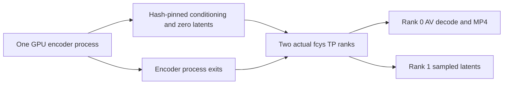

# Actual fcys TP2 low-RAM staged canary — October 28, 2026

**Later AMD encoder-format comparison:** [W4A8 default/native HIP INT8 versus corrected NVFP4](H3-AMD-ENCODER-FORMATS-2026-10-28.md) records three fresh timed trials per path and nine paired TP2 quality clips. Encoder-stage speed, loading variance, memory and quality limits are separated. Production remains unchanged; earlier results below stay historical.

**Later conditioning repair:** [the corrected actual TP2 and one-card 39-frame controls](H3-FCYS-QUALITY-FIX-2026-10-28.md) identify all-NaN conditioning from the opt-in Triton NVFP4 path. Encoder-only Triton disablement restores finite conditioning and sampled red-teapot output; corrected preprocessing/TP2 retain at least 11.286 GiB host RAM available. Earlier failures and measurements below remain historical. No production promotion or new speedup.

**The memory optimization works for the tested five-frame canary.** The unchanged full workflow with aligned 1 GiB host guards still stopped at 0.974 GiB during duplicate text-encoder loading. A staged design then completed actual two-rank fcys RCCL sampling, all 20 steps, and rank-0 audio/video export while retaining at least **10.829 GiB available system RAM** across its two stages.

The export is decodable and the rank-1 latents are finite, but visual prompt compliance fails: two small wild canids in grass instead of the requested red ceramic teapot. This is the same qualitative symptom as the earlier five-frame one-card control. The candidate therefore has a functional/memory pass, not a full quality or production qualification. No matched timed benchmark or new speedup is claimed.

## How CPU memory was reduced

The encoder uses ComfyUI's `initial_device=cuda:0` option, with GPU load device and CPU offload device retained. The completed preprocessing process reported all **1,003 encoder parameters on GPU 0**, 14.626 GiB Torch-allocated VRAM and 16.588 GiB reserved. Initializing both encoders in VRAM alone was insufficient; the essential structural change is avoiding two simultaneous encoder processes and releasing preprocessing before loading TP2. Only rank 0 loads the audio/video decoders, avoiding a second unused decoder pair.

The 1,722,475-byte input fixture contains only CPU conditioning tensors, metadata and zero AV latents. Both ranks loaded the same SHA256 `60acd641ae385938519a6cc57c7399e86a77ad7f290511cf91e74969bc5da598`. Its primitive/tensor serialization uses `weights_only=True` on load and restores the AV nested-tensor structure. Prompt, checkpoint storage, dimensions, frame count, sampler, scheduler, steps and CPU noise seed remain fixed. This is a new execution design, separate from the unchanged-workflow retry and from the earlier davoddino host-staged prototype.

## Source, stack and integration

The four [fcys tp2-comfy v1.0.0 source files](https://lcz.me/topic/2643/17) remain untouched and privately hash-pinned. Stack: ComfyUI 0.42.0 source `8f04fd6ecf4a548937971e840af2a985529fab76`, Torch `2.15.0.dev20260827+rocm7.2`, HIP 7.2.53211, comfy-kitchen 0.2.39 and INT8 plugin revision `6b28bf637782d25225a88e316d864a8f551be000`. CK attention, BF16 compute/wire, no-P2P SHM transport, one communication channel and 1 MiB buffers remain. The workload is 608×352×5 at 24 fps, 20 res_multistep/simple steps, seed 42 and batch 1.

ComfyUI 0.42 registers the plugin in a path-derived namespace, while the posted TP code imports its canonical package name. A small isolated bridge aliases that name to the existing module instance, rather than importing a second plugin. Both workers verified identity of the quantizer, fused kernel, ConvRot and loader operation classes before queueing. The actual model hook confirmed 28 heads, QKV output 10752, output-projection input 3584, FC1 output 14336 and FC2 input 7168 on each rank. These successful checks do not establish full-model numerical equivalence.

The updater download/write import remains disabled only in the isolated plugin copy. Source with unclear redistribution permission is not bundled. The private candidate wrappers and their hashes are preserved for continuation; nothing was installed in the production runtime.

## All new attempts and guard handling

| Attempt | Result | Min host available GiB | Min free VRAM, card 0 / card 1 GiB |
|---|---|---:|---:|
| Residual 2 GiB monitor setup | harness_failed | 1.593 | 11.785 / 11.816 |
| Same workflow, aligned 1 GiB | guard_stopped | 0.974 | 10.569 / 10.796 |
| GPU-init polling setup | harness_failed | 8.803 | 16.918 / 17.031 |
| Two encoders, GPU init | guard_stopped | 0.682 | 10.656 / 10.385 |
| One encoder preprocessing | passed | 10.953 | 6.236 / 23.958 |
| Shared TP2 import setup | failed | 12.790 | 23.696 / 23.727 |
| Shared TP2 + one decoder | passed | 10.829 | 7.098 / 13.117 |

The first 1 GiB attempt was not a valid aligned-floor run: an independent swap monitor still used its default 2 GiB host floor. Both host checks were then set to the explicitly requested 1 GiB value **inside the isolated controller process only**. The valid unchanged-workflow retry and valid two-encoder GPU-init candidate still hit the 1 GiB host guard. The latter sampled minimum overshot the threshold to 0.682 GiB before shutdown; a latched stop is not a claim that a sampled floor was never crossed.

One GPU-init setup attempt timed out polling history while loading; the controller now retries transient polling timeouts until its bounded deadline while the independent memory watchdog continues. The first shared-TP attempt reached model construction but exposed the namespace mismatch fixed by the bridge. These integration/setup failures are preserved separately from guard failures and the final functional pass.

Two setup attempts reported delayed descendant exit at the initial cleanup check, so their GPU locks were retained. Exact owned-unit inactivity, the reported PID exits and empty KFD clients were subsequently verified before releasing only the matching dead-owner locks. Their original records remain unchanged with separate cleanup audits. The successful final stages verified shutdown directly.

All attempts retained loading-swap-v3: loading/parked swap and reads are allowed, rates/PSI are advisory and no new write budget was introduced. The successful preprocessing/TP stages reached 6.512/10.711 GiB owned swap respectively; swap itself did not stop them. All other guards remain: 2 GiB free-VRAM soft floor over four samples, 1.5 GiB hard floor, zero dedicated spill, physical-RAM scope cap, ownership locks and lifecycle thermals. Production guard files, profiles, pins, launchers and paused schedules remain unchanged.

## Media and thermal verification

Rank 0 exported five distinct 608×352 H.264 frames at 24 fps (0.208333 s), with stereo 32 kHz AAC audio (0.200000 s). FFmpeg decoded both streams without errors. Audio samples were finite, peak 0.067050 and RMS 0.011553. Rank 1's float32 video `[1,24,2,22,38]` and audio `[1,32,2,8]` sampled latents are finite. Frames 1/3/5 visibly fail the submitted teapot prompt; audio semantics and long-range motion cannot be qualified from this 0.2 s clip. Backend/loader/frame-count/conditioning causes remain unisolated.

| Successful stage | Thermal samples / errors | GPU junction peaks °C, card 0 / card 1 | CPU package peak °C |
|---|---:|---:|---:|
| One encoder preprocessing | 177 / 0 | 62.0 / 36.0 | 69.0 |
| Shared TP2 + one decoder | 132 / 0 | 64.0 / 63.0 | 81.0 |

The [numeric record](../hardware/results/h3-fcys-lowram-2026-10-28.json) includes every attempt's memory, scope, coverage and available SMU observations. Sensor peaks are sampled, and flags are not measured time throttled or proof of a speed loss. Lifecycle durations include loading and shutdown; no excluded-warmup/three-trial timing series was run. Earlier 39-frame prototype medians retain their original implementation and method.

All owned work has exited and GPU/server locks are clear. Keep this memory-feasible staged candidate isolated. Resolve prompt compliance with matched conditioning/backend/loader/frame-count controls before larger or timed tests; no production promotion or native Radiance qualification follows.
