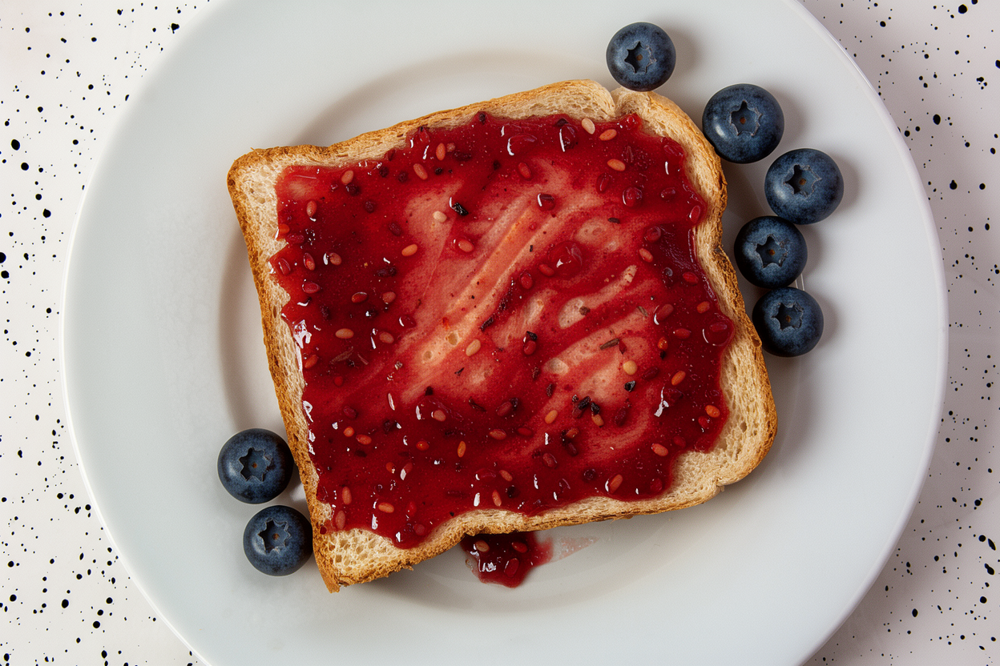

# Generated image and video test results — November 5, 2026

These are the existing outputs from seven completed graphics checks and three extended copy-coverage checks on dual RX7900XTX. No passed GPU test was rerun for publication. Scenes show a lighthouse, teapot/cup and toast. The videos are short functional samples, not a general video-quality or sustained-stability benchmark.

PNG pixels and encoded MP4 video/audio match the original outputs. Embedded generation/workflow metadata was removed; [hashes and media verification](media-manifest.json) are inspectable. Video links open the complete MP4 files, each with stereo32kHz audio.

| Output | Dimensions/duration | Validation |
|---|---|---|
| [graphics-flux-t2i](graphics-flux-t2i.png) | 1024×1024 | Finite render; PNG pixels unchanged |
| [graphics-flux-i2i](graphics-flux-i2i.png) | 1248×832 | Finite render; PNG pixels unchanged |
| [graphics-qwen-t2i](graphics-qwen-t2i.png) | 512×512 | Finite render; PNG pixels unchanged |
| [graphics-qwen-edit](graphics-qwen-edit.png) | 640×416 | Finite render; PNG pixels unchanged |
| [graphics-h3-t2v](graphics-h3-t2v.mp4) | 608×352,39frames,1.625s | Finite tensors; complete AV decode; encoded streams unchanged |
| [graphics-h3-i2v](graphics-h3-i2v.mp4) | 608×352,39frames,1.625s | Finite tensors; complete AV decode; encoded streams unchanged |
| [graphics-h3-tp2](graphics-h3-tp2.mp4) | 608×352,39frames,1.625s | Finite tensors; complete AV decode; encoded streams unchanged |
| [graphics-copy-coverage-flux](graphics-copy-coverage-flux.png) | 1024×1024 | Finite render; PNG pixels unchanged |
| [graphics-copy-coverage-qwen](graphics-copy-coverage-qwen.png) | 512×512 | Finite render; PNG pixels unchanged |
| [graphics-copy-coverage-h3](graphics-copy-coverage-h3.mp4) | 608×352,39frames,1.625s | Finite tensors; complete AV decode; encoded streams unchanged |

Normal Flux/Qwen/H3 workflows use component placement; their completed requests show no cross-GPU copy in the extended HIP/HSA-owner trace. The separate `graphics-h3-tp2` output is from the pinned fcys RCCL TP2 path with both-direction P2P/IPC selection and finite results on both ranks. Its cached conditioning excludes encoder cost. No matched speed result or normal TP2 promotion follows from this request.

See [method, transport and qualification limits](../../../hardware/ALL-MODEL-P2P-2026-11-05.md) and [per-case numeric results](../../../hardware/results/ALL-MODEL-P2P-2026-11-05.json). The images below are output previews; the complete files and videos are linked above.

### graphics-flux-t2i

### graphics-flux-i2i

### graphics-qwen-t2i

### graphics-qwen-edit

### graphics-copy-coverage-flux

### graphics-copy-coverage-qwen

